MORE WILD is a brand concept for a UK conservation charity. We set ourselves the brief a real charity would give us and worked it through to the end: strategy, logo, a typeface of its own, a picture mark, guidelines and a working website. This page is about why each piece is the way it is.

MORE WILD is a concept. It isn't a real charity, and it has nothing to do with any company or organisation that shares the name.

## The Problem

Conservation charities are easy to confuse with one another. The same leaf green, the same photograph of an animal looking at you sadly, the same message that it is nearly too late. It's honest about the stakes, but it asks people to feel guilty, and guilt gets scrolled past. A hopeful brand gets worn on a T-shirt.

## The Brief

A charity with a simple promise: more nature, more life, more possibility. We ruled out three things before drawing anything: leaf green as the default, sad animals, and guilt. The identity had to work from an app icon to a bus shelter, read clearly for everyone, and be owned by the charity rather than borrowed. That last one ended up deciding the most.

## The Solution

### One idea: make room

A conservation charity's whole job is giving nature more room. So the name does it first. MORE is squeezed narrow and WILD is given the space, and the two measure exactly two parts to three.

Everything else in the brand makes the same move, from narrow to wide. The page grid is two columns to three. Photographs sit in bars that widen as they go, in the proportions 1, 2, 3, 5, 8, the way growth adds up. And the one animation the brand owns is a thing getting wider.

We wanted an idea you could explain to a trustee in one sentence and a designer could apply without a rulebook. "Make room" passed both tests.

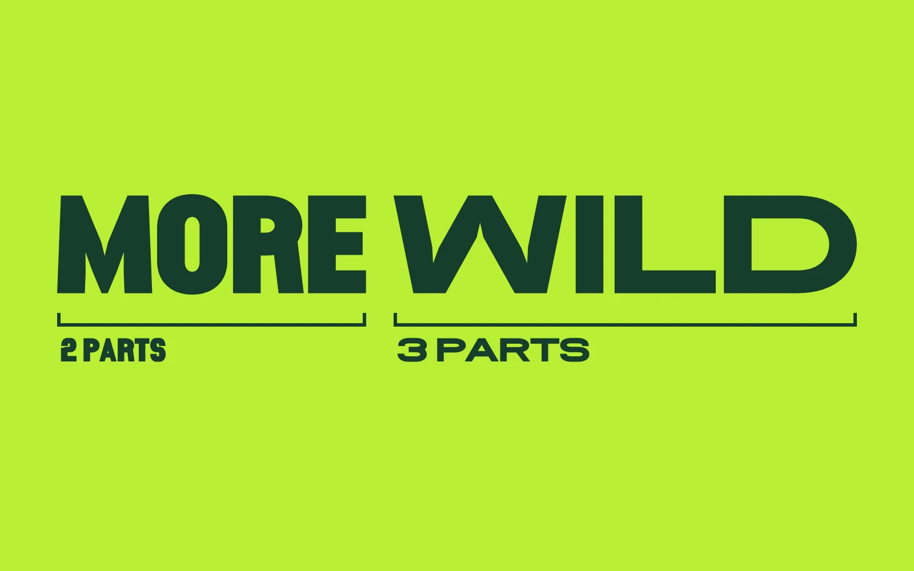

### Why we drew a typeface

The first version of the logo used a typeface off the shelf. It worked, and it looked like a lot of other brands, because the good free grotesques are everywhere now. It also had a problem we couldn't design around. When an ordinary font goes from narrow to wide, its strokes get thinner or fatter along the way, so MORE and WILD looked like two different fonts sat next to each other.

So we drew our own and called it Clearing. It is built from five rules, and each one is there to do a job:

- **Strokes keep one thickness at every width.** When a letter gets wider, all the new room goes inside it. That is the brand's idea at the size of a single letter, and it is why the two words read as one voice.
- **Round letters are pebbles.** Stood on end when narrow, lying down when wide, and never a perfect circle. Circles would have looked like a tech company.
- **Curves end in a level cut.** C, G and S stop on a flat edge, so lines of type stack like blocks of colour with no gaps between them.
- **A nick where strokes meet.** Heavy letters fill in at the joins when they are stitched on a cap or printed small. A small wedge cut out of each join keeps them open.
- **W is M turned over.** The name's two initials are one shape, used twice.

It has 96 characters: capitals, numerals, the pound sign and per cent for fundraising headlines, and accented capitals for Welsh, Gaelic and Irish place names, because a UK charity will need to set Ynys Môn and "£10 a month" in its headline type on day one.

Two letters were redrawn after we lived with them. The first W had upright sides, which made it ownable but forced; leaning the M's legs out slightly fixed both letters at once. And the narrow K read like a backwards N until its arm moved up the stem.

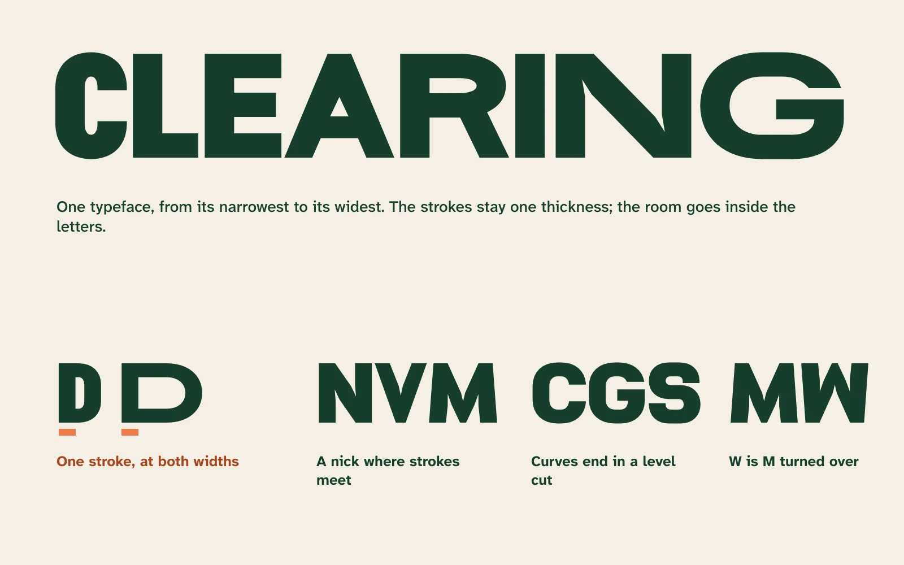

### Why a hare

A wordmark can't be an app icon, so the brand needed a picture mark as well. We explored five animals and chose the hare for three reasons.

It has no burrow. A hare lives out in the open, so it only thrives where there is room. That is the charity's argument in one animal.

You know it by its ears. The mark is one flat shape with one eye, with nothing that falls apart when it is small, so it reads as a hare at 16 pixels and on the side of a van.

And it has two shapes. Sitting, a hare is narrow. Running, it is wide. Those are the two words of the name again, so the mark has a sitting form for icons and tight corners, a running form for anything long and low, and a leap between the two that is the same move the wordmark makes.

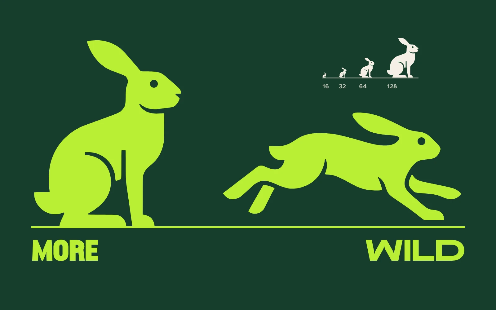

  <video controls loop muted playsinline preload="none" poster="/images/more-wild/hare-leap-poster.webp" width="1080" height="1080" class="rounded-2xl w-full h-auto" aria-label="The MORE WILD hare sits, leaps into its running pose and settles back again">
    <source src="/images/more-wild/hare-leap.mp4" type="video/mp4" />
  </video>
  
The leap. On the website it plays once in the header and again in the footer, and it stays still for anyone who has asked their device for less motion.

### Colour, and why it isn't leaf green

The lead colour is the green of new growth, the first leaves of spring, not the dark green of a mature canopy that most nature charities use. It is hopeful, and it is a long way from the sector's usual green.

#### Colour Palette

- **Electric Wild (#B9EF35)** - the signature. Big fields, buttons, the logo's home ground.
- **Deep Forest (#173D2B)** - type and logo on the lime, and the calm dark fields.
- **Natural Cream (#F4F0E5)** - the page.
- **Almost Black (#20231F)** - body text and the most serious moments.
- **Wild Orange (#F07848)** - asking and campaigning: donations, appeals, posters that need to shout.
- **Living Green (#82B8A0)** - the quiet one, for evidence, reports and tips.

Every pairing the brand allows was checked by calculation rather than by eye. Forest on lime is 8.9 to 1 and body text on cream is 14 to 1, both well past the accessibility standard, and the guidelines list the pairings that are for large type only.

#### Typography

Clearing is for headlines only. Reading text is Atkinson Hyperlegible Next, a typeface made for the Braille Institute so that letters are hard to mistake for one another. A charity talks to everybody, including people who find small type hard work, so the reading face was chosen for them.

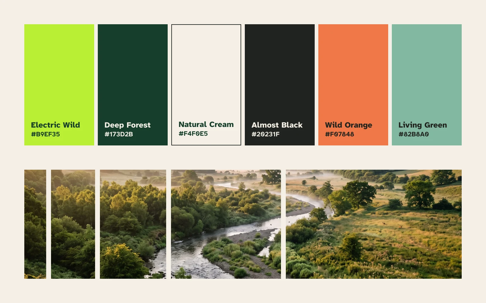

### Out in the world

An identity for a charity lives on things: posters, vans, caps, T-shirts, collection tins. These mock-ups were made from the real logo files to test whether the idea survives at every size, and it is where the long running-hare version of the logo earned its place, on the side of a van.

  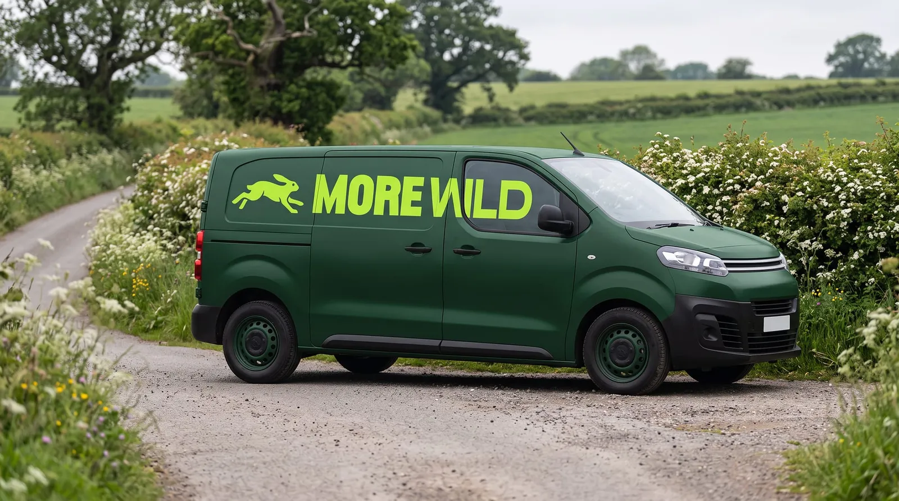
  

    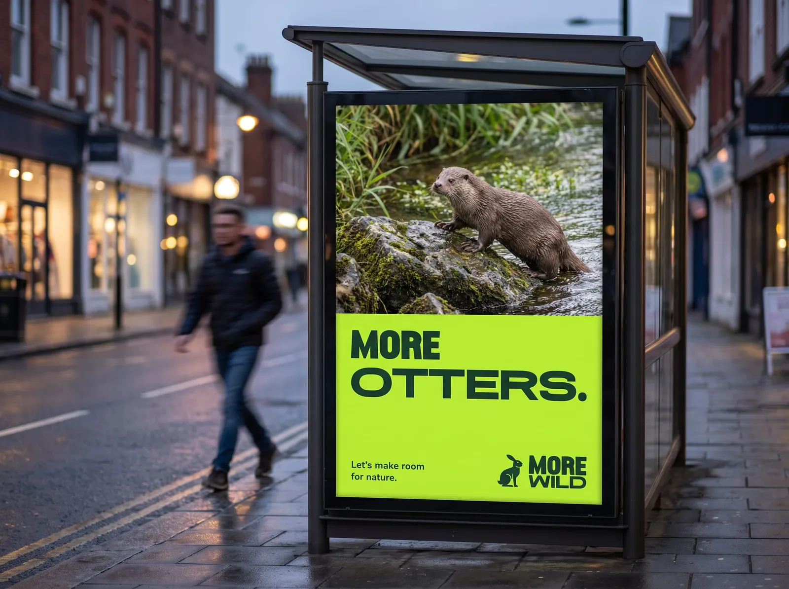
    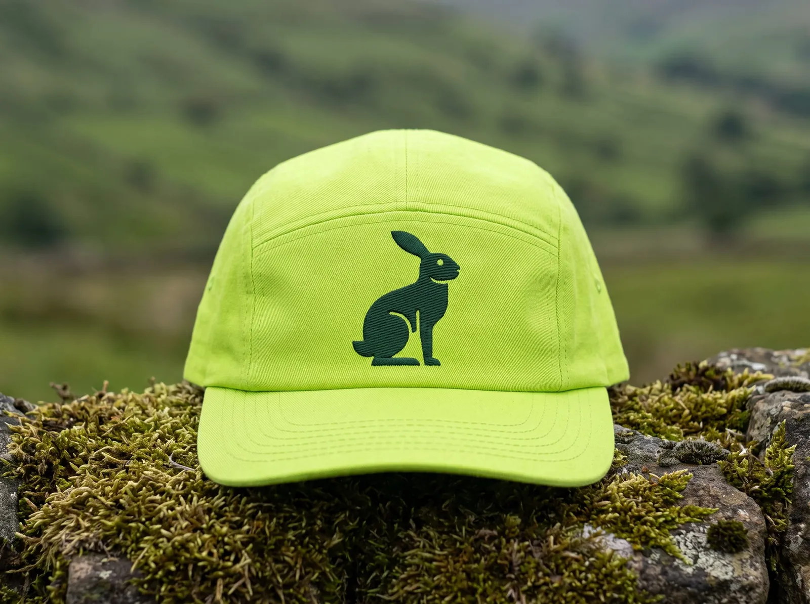
  

The posters show how far the name stretches. MORE stays narrow and whatever the charity wants more of is set wide: more otters, more thriving, more habitat.

  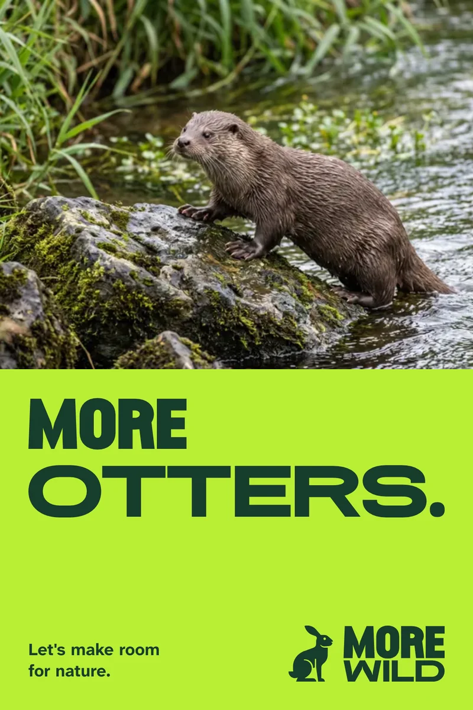
  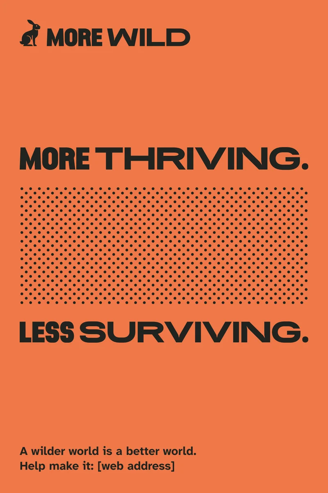
  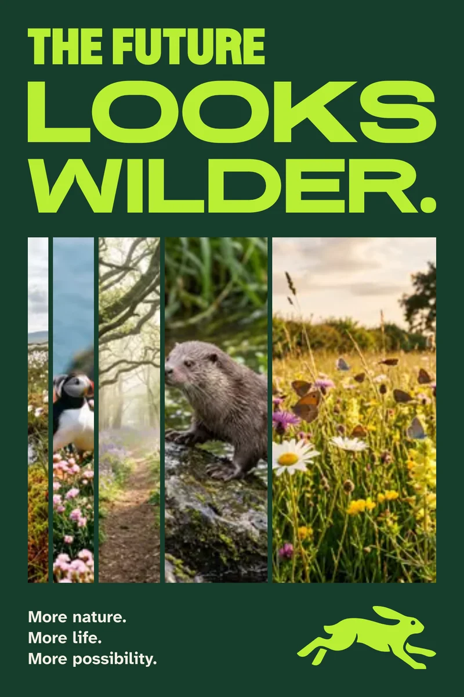

### The website

The site is a working prototype in Next.js, with eight pages from the mission to a donation form. Its headlines fill the width of the screen edge to edge, the way Victorian playbills did, and they are sized from the typeface's own measurements instead of being measured in the browser, so nothing jumps while the page loads.

It was checked at four screen sizes in both the Safari and Chrome engines, the hare's leap runs at 60 frames a second, and the forms say plainly that they are a prototype and send nothing. The photographs are stand-ins. A real conservation charity would commission its own, of real places and real animals, and the guidelines say so.

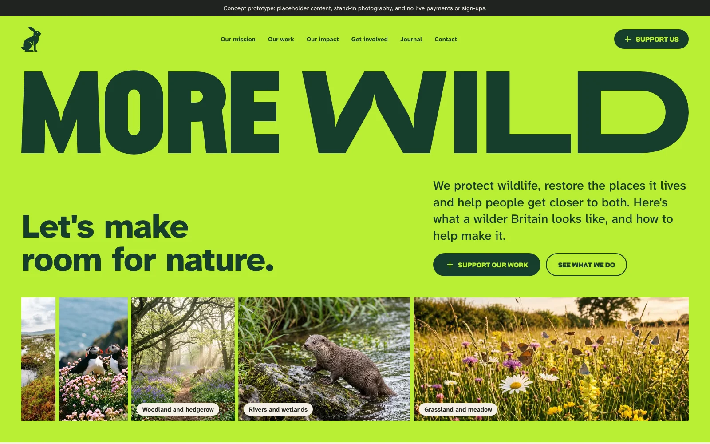

  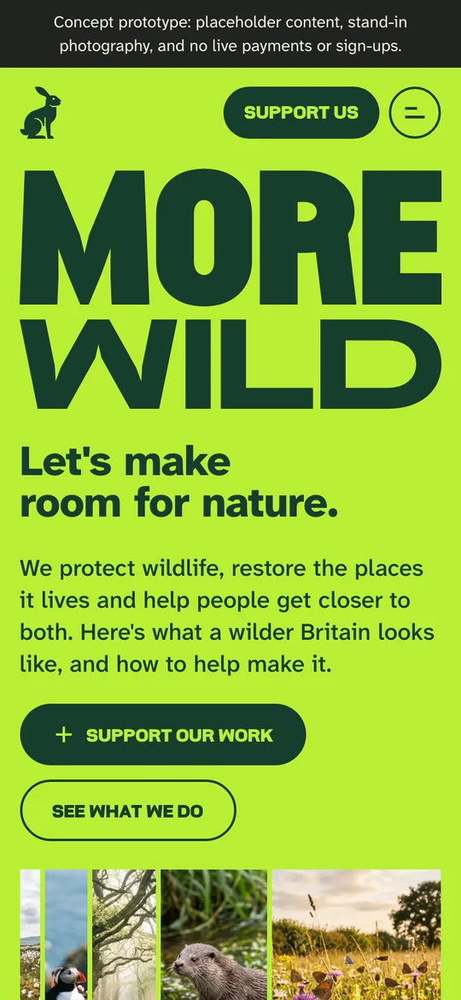
  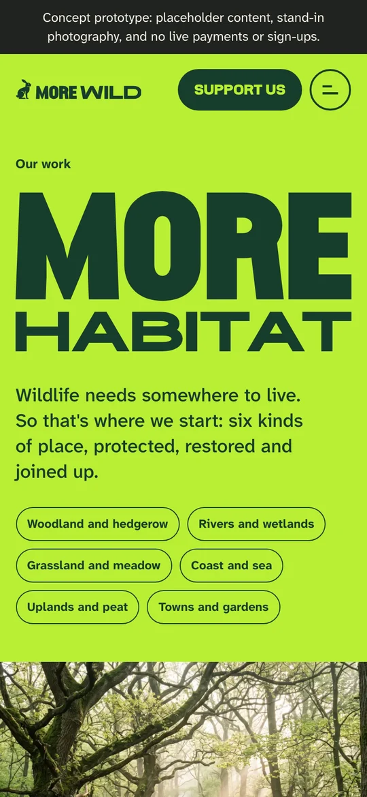
  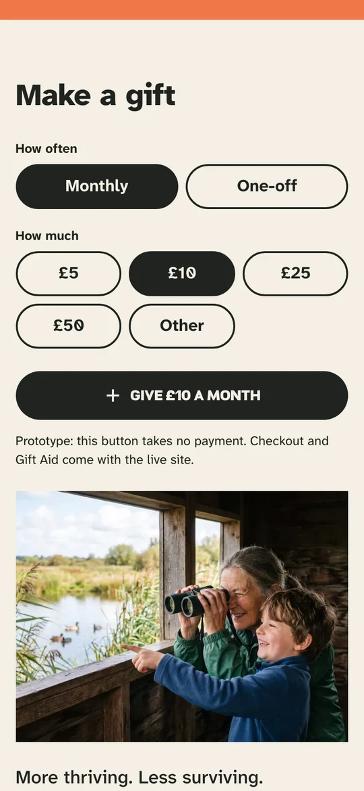

## What We Built

- Brand strategy: positioning, the idea, tone of voice and messaging
- Logo system: wordmark, stacked logo, two forms of the hare, three lockups, in four colours
- Clearing, a variable display typeface, as installable font files
- The hare's leap, as a web component and as animation files
- Colour, type, graphic language, icon and photography direction, in brand guidelines
- Applications: posters, social posts, signage, clothing, a vehicle and fundraising pieces
- A working website in Next.js, TypeScript and Tailwind, with a reusable design system

If you run a charity or a business and want an identity where every decision has a reason behind it, [tell us about it](/contact/) or see our [branding work](/services/branding/).
